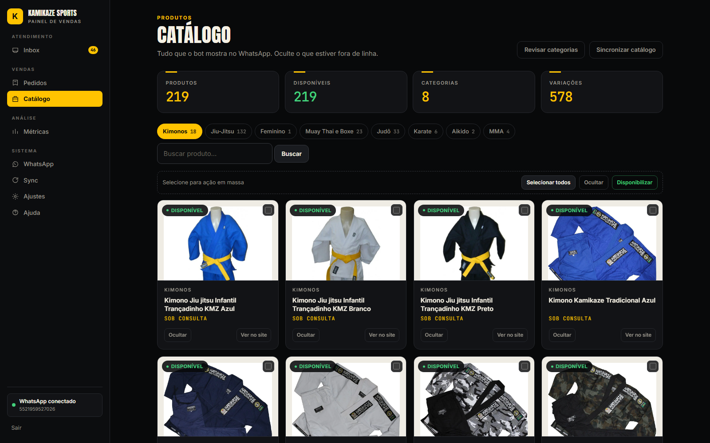
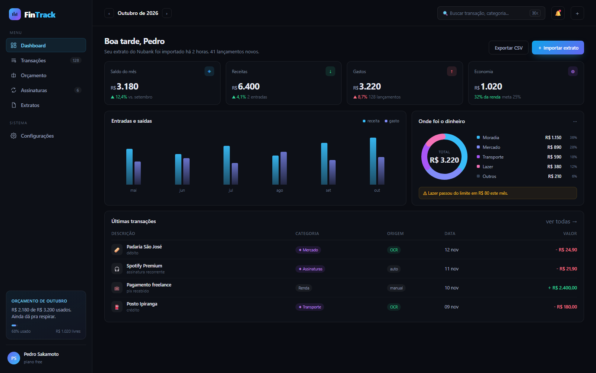
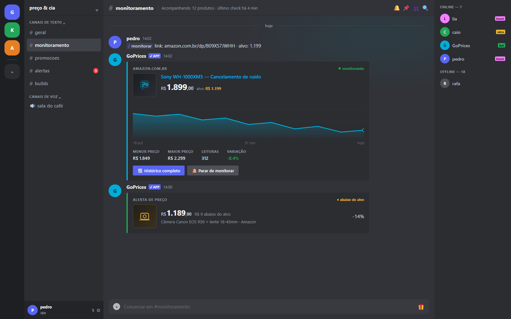
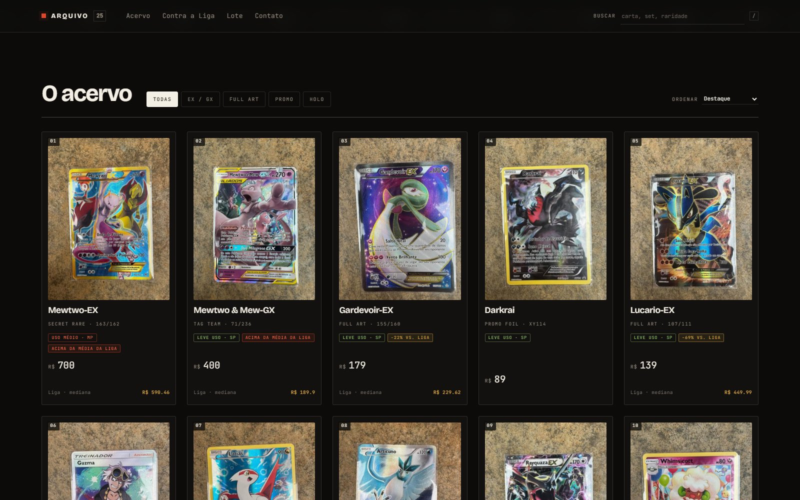

# Pedro Sakamoto — Portfólio


Portfólio de dev back-end que também é um sistema: conteúdo dinâmico servido por uma API Express + PostgreSQL, painel administrativo próprio, currículo versionado com auditoria ATS e um pipeline de vagas que publica uma lista estática consumida pelo site.

O site é o projeto. Os cases são sistemas que rodaram de verdade — bot vendido para uma loja, SaaS com checkout, bot de Discord, extensão de Chrome. Cada um tem screenshot, decisões e o que eu faria diferente.

**Produção:** [www.pedrosakamoto.site](https://www.pedrosakamoto.site)

---

## Capturas

| Kamikaze Bot | FinTrack |
| --- | --- |
|  |  |
| **GoPrices** | **Arquivo (Pokémon)** |
|  |  |

---

## Rotas

| Rota | O que é |
| --- | --- |
| `/` | Home: hero, sobre, stack, projetos, open source, contato |
| `/projetos/:slug` | Case study com arquitetura, decisões, resultados e galeria |
| `/curriculo` | Currículo público (PT) — `?lang=en` para a versão em inglês |
| `/vagas` | Lista de vagas gerada pelo StartANewDay (`/jobs.json`) |
| `/arquitetura` | Diagrama e trade-offs da stack |
| `/admin` | Painel: projetos, skills, conteúdo, carreira e currículo |

Currículos prontos para envio: [`public/curriculo/curriculo-pedro-sakamoto.pdf`](public/curriculo/curriculo-pedro-sakamoto.pdf) e [`public/curriculo/resume-pedro-sakamoto-en.pdf`](public/curriculo/resume-pedro-sakamoto-en.pdf) - duas páginas cada, geradas a partir da página pública.

---

## Stack

**Frontend** — React 18, TypeScript, Vite, React Router, TanStack Query, Tailwind + CSS próprio, Lenis, Lucide.

**Backend** — Node.js 22, Express 5, PostgreSQL (Supabase), JWT, Zod, Helmet, rate limiting, Pino.

**Infra** — Vercel (SPA + serverless functions), Supabase, GitHub Actions (lint, typecheck, testes, build), PWA via `vite-plugin-pwa`.

---

## Estrutura

```
portfolio/
├── src/
│   ├── components/          # UI pública e blocos compartilhados
│   ├── pages/
│   │   ├── Admin/           # Painel (projetos, skills, currículo, carreira)
│   │   ├── Index.tsx        # Home
│   │   ├── ProjectDetail.tsx
│   │   ├── Curriculo.tsx
│   │   └── Vagas.tsx
│   ├── lib/                 # API client, dados do currículo, motor ATS, cases
│   ├── hooks/               # React Query para API pública e admin
│   ├── editorial.css        # Camada de acabamento e motion (após index.css)
│   └── index.css            # Tokens, layout e estilos base
├── server/
│   ├── routes/              # projects, site, skills, auth, jobs, maintenance
│   ├── middleware/          # Auth e validação
│   └── db.js                # Pool e schema
├── migrations/              # 001 → 007, idempotentes
├── api/                     # Entry point das serverless functions
└── public/
    ├── curriculo/           # PDFs PT/EN
    ├── projetos/            # capas, galerias e screenshots dos cases
    └── jobs.json            # vagas publicadas pelo StartANewDay
```

Os cases fixos ficam em [`src/lib/featured.ts`](src/lib/featured.ts) — entram no topo da listagem mesmo quando a API não devolve nada. Alguns são de código fechado, e o campo `context` existe para deixar isso explícito (o Kamikaze, por exemplo, é projeto vendido).

---

## Currículo como modelo de dados

O currículo não é uma página estática: é um registro em `site_info` (`resume_data`, `resume_data_en`) editado em `/admin/curriculo`.

- `src/lib/resume-data.ts` — modelo canônico PT/EN (experiência, formação na Unaerp, skills, projetos, idiomas).
- `src/lib/resume-audit.ts` — auditoria determinística com 10 verificações ponderadas (contato, resumo, formação, bullets com resultado, verbos de ação, palavras-chave ATS, links), sugestões acionáveis, export em texto puro e um prompt pronto para reescrita com IA.
- `/admin/curriculo` — três abas: **Conteúdo**, **Análise & IA**, **Exportar**. A análise roda no navegador, sem chamada externa.
- `/curriculo` — renderiza o modelo salvo (com fallback para o padrão), alterna PT/EN por querystring e imprime em A4.

Sempre que o modelo muda, os PDFs de `public/curriculo/` são regerados a partir da própria página.

---

## Pipeline de vagas

`server/routes/jobs.js` agrega Remotive, Jobicy, Arbeitnow e RemoteOK, normaliza senioridade/região/modalidade e calcula compatibilidade com o perfil. O resultado é publicado em `public/jobs.json` e consumido por `/vagas`. O app completo (busca, automação com Playwright e envio) roda localmente no projeto StartANewDay.

---

## Projetos em destaque

| Projeto | O que é | Stack |
| --- | --- | --- |
| [Kamikaze Bot](https://www.pedrosakamoto.site/projetos/kamikaze-bot) | **Projeto vendido** para a Kamikaze Sports: bot de WhatsApp com catálogo real, estoque, pedido e painel de operação na loja. Não é projeto pessoal. | TypeScript, Baileys, Hono, SQLite, Playwright |
| [ImportFlow](https://www.pedrosakamoto.site/projetos/importflow) | SaaS de importação com checkout (cartão, Pix, boleto), webhook assinado e admin. Código abre em breve. | React, Supabase, Stripe, Edge Functions |
| [StartANewDay](https://www.pedrosakamoto.site/projetos/startanewday) | Painel local que busca vaga, calcula match, monta rascunho e acompanha candidatura. É o motor da página `/vagas`. | Node.js, Express, Playwright, React |
| [Arquivo](https://www.pedrosakamoto.site/projetos/arquivo-pokemon) | Vitrine de 25 cartas Pokémon com estado, preço e comparação com a Liga; painel local e anúncio na OLX/Facebook. A Mewtwo-EX 163/162 saiu por R$ 550. | HTML, CSS, JavaScript, Node.js, CDP |
| [FinTrack](https://www.pedrosakamoto.site/projetos/fintrack) | Finanças pessoais com leitura de extrato por OCR, categorização e orçamento. Roda no docker-compose. | Java, Spring Boot, Next.js, PostgreSQL |
| [Detox Digital](https://www.pedrosakamoto.site/projetos/detoxdigital) | Back-end Spring Boot + extensão Chrome que mede tempo em site de distração e avisa no limite. | Java, Spring Boot, Chrome MV3, Thymeleaf |
| [GoPrices](https://www.pedrosakamoto.site/projetos/goprices) | Bot de Discord em Go que acompanha preço, guarda histórico, desenha gráfico e alerta quando cai. | Go, discordgo, colly, SQLite |
| [badgesPlus](https://www.pedrosakamoto.site/projetos/badgesplus) | Plugin Vencord que mostra a badge do perfil no chat e na lista de membros, com busca por badge. | TypeScript, React, Vencord |
| [Treino Seguro 60+](https://www.pedrosakamoto.site/projetos/treino-seguro-60) | Produto digital para 60+: ebook, página de venda, marca, criativos e campanha no Meta Ads. | HTML, CSS, Design, Copy, Cakto |

---

## Rodando local

```bash
git clone https://github.com/2jjj/portfolio.git
cd portfolio
npm install
cp .env.example .env        # preencha as variáveis
npm run dev:server          # API em http://localhost:3001
npm run dev                 # front em http://localhost:8080
```

### Variáveis de ambiente

| Variável | Descrição | Obrigatória |
| --- | --- | --- |
| `DATABASE_URL` | Conexão PostgreSQL | Sim |
| `JWT_SECRET` | Assinatura dos tokens do admin | Sim |
| `ADMIN_PASSWORD` | Senha inicial do painel | Sim |
| `MAINTENANCE_TOKEN` | Habilita migrations em produção | Não |
| `GITHUB_USERNAME` | Importação de repositórios | Não |
| `VITE_API_URL` | URL da API (vazio = mesma origem) | Não |
| `VITE_FORMSPREE_URL` | Endpoint do formulário de contato | Não |

### Scripts

```bash
npm run dev          # Vite (8080, proxy /api → 3001)
npm run dev:server   # Express (3001)
npm run build        # tsc -b + vite build
npm run start        # servidor em produção
npm run test         # Vitest
npm run test:watch
npm run test:coverage
npm run typecheck
npm run lint
```

---

## Qualidade

- `npx tsc --noEmit` e `npm run lint` sem avisos.
- Vitest com testes de componentes, validação e motor ATS.
- `prefers-reduced-motion` respeitado em toda a camada de animação.
- Acessibilidade: skip link, foco visível, landmarks, `aria-label` em ícones, contraste testado nos dois temas (escuro/claro).

---

## Deploy

O deploy de produção é feito na Vercel (`vercel --prod`). Push em `main` dispara o CI; o deploy automático por push está desativado para evitar builds duplicados.

Migrations rodam automaticamente apenas em ambiente local. Em produção, defina `MAINTENANCE_TOKEN` e chame:

```bash
curl -X POST https://www.pedrosakamoto.site/api/maintenance/migrate \
  -H "Authorization: Bearer $MAINTENANCE_TOKEN" \
  -H "Content-Type: application/json" \
  -d "{}"
```

---

## Licença

MIT — veja [LICENSE](LICENSE). Use como referência, fork ou base; só mantenha o aviso de copyright.

**Contato** — [pedrosakamoto27@gmail.com](mailto:pedrosakamoto27@gmail.com) · [LinkedIn](https://www.linkedin.com/in/pedro-sakamoto-3b94091a1/) · [GitHub](https://github.com/2jjj)
